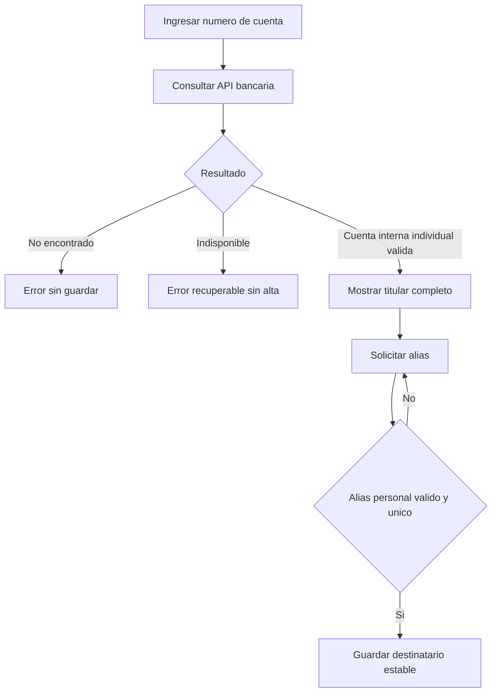
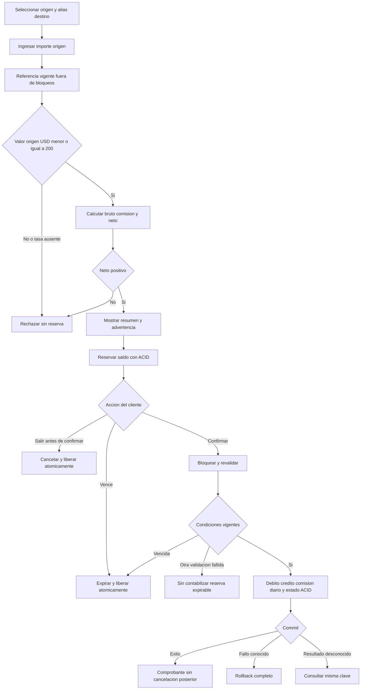
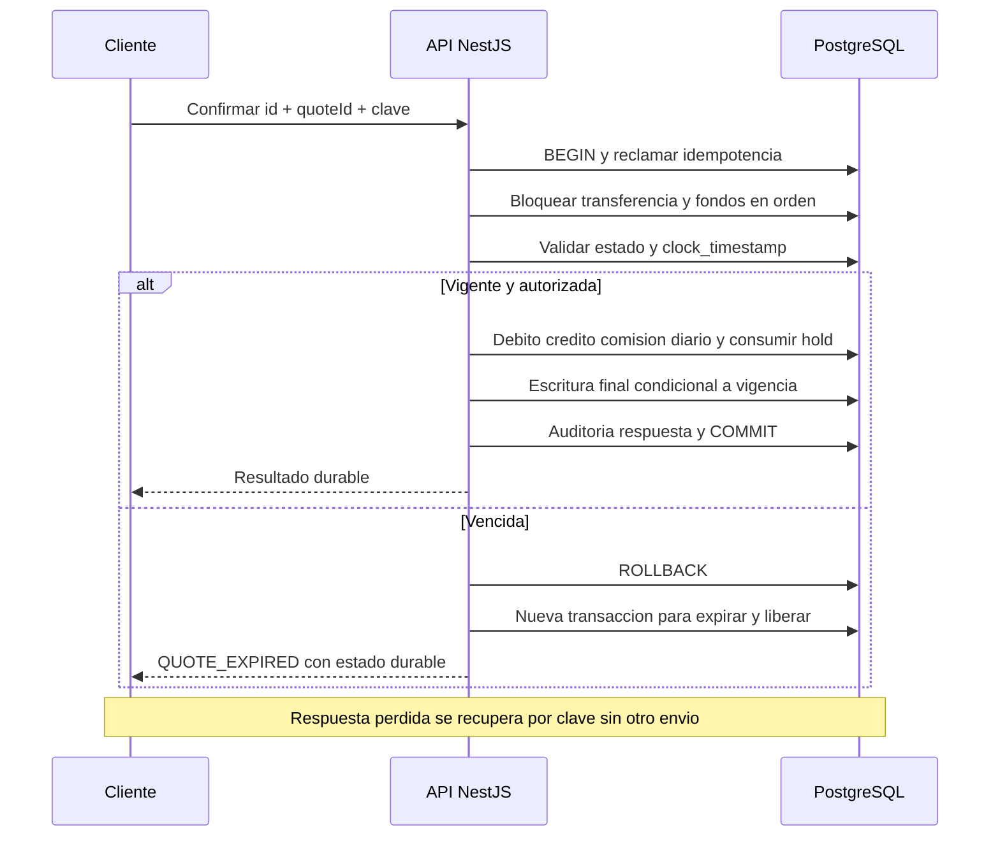

# PLAN-TRANSFER: diseno tecnico de transferencias internas

## 1. Estado y decisiones

- Version: 0.3. Estado: baseline y contratos propios aprobados en T-001; esquemas en T-009, dinero en T-010, conversion en T-011 y snapshots sinteticos en T-012 implementados; G-002 cerrada, restantes puertas abiertas y sin autorizacion de produccion.
- Referencias: [SPEC-TRANSFER.md](SPEC-TRANSFER.md), RN-001 a RN-028; [01-SPECIFICATION.md](01-SPECIFICATION.md), RF-001 a RF-018 y CA-001 a CA-020.
- Aprobado: Node.js, NestJS, PostgreSQL y ACID; USD/EUR/COP/GTQ con dos decimales; limite por importe origen equivalente a USD 200; transferencia gratis y conversion con 1% con techo entero en destino; comprobante dentro de la plataforma.
- Los endpoints y schemas siguientes son contratos propios aprobados para desarrollo en T-001, no afirmaciones sobre las APIs bancarias existentes. Backlog: [TASKS-TRANSFER.md](TASKS-TRANSFER.md). Las aprobaciones pendientes de negocio y proveedor conservan sus bloqueos.

| ID | Decision y justificacion | Estado |
| --- | --- | --- |
| DT-001 | Monolito modular NestJS: destinatarios, cotizaciones, transferencias, contabilidad y comprobantes en una frontera ACID. | Aprobada por el usuario en T-001; autoridad unica de este backend y frontera ACID confirmadas en T-003/G-003 el 2026-11-03. |
| DT-002 | PostgreSQL READ COMMITTED con bloqueos explicitos, restricciones y una via de escritura de fondos; evita sobregiros sin serializar toda la plataforma. | Aprobada en T-001; demostracion por concurrencia real pendiente, no prueba ejecutada. |
| DT-003 | Importes finales en BIGINT de unidades minimas; decimal.js para calculos y aritmetica racional para limites; JSON con strings monetarios. | Aprobada en T-001; implementacion y compatibilidad pendientes de T-008 en adelante. |
| DT-004 | Bruto HALF_UP a dos decimales; comision CEILING(bruto cuantizado * 0.01) a enteros; neto = bruto - comision. Conservar exactos, finales y diferencias. | Aprobada por el usuario el 2026-11-03; G-002 cerrada. |
| DT-005 | Resumen inmutable y reserva de hasta 60 segundos desde emision en todos los pares; igual moneda no tiene cotizacion comercial FX, pero los pares no USD requieren referencia vigente origen/USD para el limite. Reservar no prolonga vigencia. | Aprobada por el usuario el 2026-11-03; G-002 cerrada. |
| DT-006 | Alias unico por cliente tras trim y normalizacion case-insensitive; cuenta estable y copia historica del alias/titular. | Aprobada por el usuario el 2026-11-03; politica de edicion pendiente. |
| DT-007 | Cuentas propias deshabilitadas en fase 1; sin correcciones administrativas en estos endpoints. | Aprobada por el usuario el 2026-11-03. |

## 2. Frontera ACID e integraciones bancarias

Balances autorizados, reservas, transferencias, diarios, auditoria monetaria y respuestas de idempotencia deben estar en la misma PostgreSQL. Las APIs de directorio y tasas se consultan fuera de los bloqueos monetarios; se validan y persisten snapshots. No se mantiene una transaccion abierta esperando red.

**Frontera aprobada en T-003/G-003 el 2026-11-03:** este backend es el escritor unico de saldos, reservas y ledger; esos registros se persisten en la misma PostgreSQL y sus efectos comparten una transaccion. No se mantiene una copia eventualmente consistente ni se delegan debitos/creditos a llamadas HTTP separadas. Cualquier futuro cambio de autoridad requiere revisar esta arquitectura; no introducir Saga sin autorizacion.

Puertos internos propuestos, no contratos del proveedor:

- AccountDirectory.lookup(accountNumber): cuenta estable, titular, moneda, tipo de persona, banco y estado, o NOT_FOUND/UNAVAILABLE. Verificar cuenta interna de persona individual antes del alta.
- RateProvider.snapshot(): referencias positivas, vigentes y autenticadas, con version y politica de valoracion acordada. El adaptador no inventa tasas faltantes ni fechas de negocio.
- AuthContext: customerId y permisos de identidad autenticada; nunca confiar en propietario enviado por cliente.

Ejemplo recibido, confirmado como ilustrativo:

```json
[{"USD":{"EUR":1.1,"GTQ":7.71},"EUR":{"GTQ":7.2,"USD":0.9}}]
```

Faltan COP, pares y vigencia; 1.1 * 7.2 = 7.92 no coincide con 7.71 y 1.1 * 0.9 = 0.99 no prueba reciprocidad. Pueden existir precios direccionales: no declarar invalidez solo por no ser reciprocos. No elegir arbitrariamente directo, inverso o cruce GTQ. Hasta acordar contrato/politica reales, produccion queda bloqueada para calculos dependientes. Pruebas con snapshots sinteticos claramente identificados como fixtures.

Si se aprueba GTQ por unidad, guardar q(USD), q(EUR), q(COP), q(GTQ)=1 en version temporal coherente. Para origen A y destino B: tasa = q(A)/q(B). Evaluar limite como importeA * q(A) <= 200 * q(USD), convirtiendo decimales a enteros escalados, sin redondear cocientes periodicos. Si se aprueban pares comerciales directos, definir por separado tasa de conversion y referencia A/USD autorizada para limite en el mismo snapshot; no imponer cruces GTQ.

## 3. Modelo de datos y restricciones

| Entidad | Campos y restricciones |
| --- | --- |
| wallets / balances | UUID, customer_id, moneda, estado; posted_minor y reserved_minor BIGINT; CHECK posted_minor >= reserved_minor AND reserved_minor >= 0. Una fila por billetera. |
| recipient_lookups | id, cliente, cuenta validada, titular, moneda, estado y vencimiento de evidencia. TTL de cinco minutos aprobado el 2026-11-03; controles de seguridad/rate limiting siguen sujetos a G-007. |
| recipients | id, cliente, wallet_id estable, alias, alias_normalizado, estado; UNIQUE(cliente, alias_normalizado). Numero de cuenta como texto, no numero aritmetico. |
| rate_snapshots | id/version, fuente, received_at, as_of/valid_until verificados, politica y referencias exactas; inmutables. |
| transfer_quotes | id, cliente, origen, recipient_id, destino estable, alias/titular historicos, snapshot opcional, origen, bruto, comision, neto, tasas exactas, valoracion USD, politica monetaria versionada, issued_at, expires_at; inmutables. |
| transfers | id, numero unico, cliente, quote_id UNIQUE, estado, version, timestamps, motivo y copia de condiciones ejecutadas. REVERTIDA no habilitada. |
| holds | id, transfer_id UNIQUE, wallet_id, amount_minor > 0, estado ACTIVA/CONSUMIDA/LIBERADA y expires_at; coherencia con transferencia al commit. |
| journals / entries | Un diario original por transferencia; lineas positivas, cuenta, moneda, DEBIT/CREDIT e importe; cuenta/moneda compatibles por FK; inmutables al contabilizar. |
| idempotency_records | UNIQUE(cliente, comando, clave), huella canonica, operacion, respuesta durable y estado de procesamiento transaccional. |
| audit_events | Actor, entidad, comando, transicion, motivo, correlacion y hora; append-only dentro de la transaccion del efecto. |

Disponible se deriva, no se escribe como tercer saldo. Reserva no genera diario definitivo. Libro y saldo materializado cambian en la misma operacion ACID.

Invariantes entre filas necesitan funciones/triggers transaccionales: bloquear encabezado del diario al modificar lineas y comprobar al cierre que cada moneda suma cero, que hay lineas y que corresponde a transferencia contabilizada. Usar constraint triggers diferidos al commit. Revocar UPDATE/DELETE del libro definitivo y escritura directa de balances al rol de aplicacion; exponer solo operaciones autorizadas. Una FK o CHECK de fila no demuestra partida doble ni coherencia reserva/transferencia.

## 4. Calculos y vigencia

1. Parsear importe decimal exacto positivo con dos decimales; convertir a unidades minimas sin Number. Limite de longitud tecnico del schema no reemplaza limite comercial.
2. Resolver permisos, origen, destinatario y snapshot vigente. USD/USD usa tasa 1 y no necesita proveedor para valorar el limite; EUR/EUR, COP/COP y GTQ/GTQ no requieren cotizacion FX, pero si referencia origen/USD para el limite.
3. Comparar origen contra USD 200 antes de comision y sin redondeo que admita excesos. Usar una version de referencia en todo el resumen.
4. Igual moneda: bruto = neto = origen y comision = 0. En conversion, cuantizar el bruto exacto con HALF_UP a dos decimales; calcular 1% sobre el bruto cuantizado y elevar la comision al entero destino siguiente si hace falta. Ejemplo: bruto 10.10, comision exacta 0.101, techo 1.00, neto 9.10. Rechazar neto <= 0.
5. issued_at del servidor; expires_at = minimo(issued_at + 60 segundos, vencimiento de referencia si aplica). Esto aplica al resumen en todos los pares; reservar no reinicia el plazo. No emitir resumen si ya no tiene vigencia positiva.
6. Guardar tasa, bruto exacto/final, diferencia de cuantizacion, comision exacta/final y diferencia, y neto. Mostrar porcentaje nominal 1% y cargo real con techo: el costo efectivo puede superar 1%; no describirlo como exactamente 1% cobrado si el techo lo aumento.

Reloj autoritativo: PostgreSQL clock_timestamp(), no cliente ni now() fijado antes de esperar bloqueos. Reservar/confirmar revalidan tras adquirirlos. Decisión aprobada en T-002: el punto de vigencia es la ultima escritura condicional de contabilizacion, despues de adquirir bloqueos, sin red posterior y con commit inmediato; no se promete que HTTP llegue o que la escritura fisica del commit termine antes del segundo 60. Un fallo de commit revierte todo.

## 5. Concurrencia y transacciones

### Orden de bloqueos

Reclamar fila de idempotencia; luego transferencia si existe, cotizacion, destinatario si su estado mutable requiere validacion, billeteras/balances en orden ascendente de UUID y diario. No invertir el orden. Administracion bloquea la misma billetera al cambiar estado. Worker de expiracion bloquea transferencia antes de fondos, igual que confirmar/cancelar. Sin red bajo bloqueos.

### Reserva

BEGIN; reclamar idempotencia; bloquear resumen no usado; validar actor, cuentas, destinatario, vigencia y limite. Actualizar reserved_minor condicionalmente solo si posted_minor - reserved_minor >= importe. Insertar transferencia RESERVADA y hold ACTIVA, consumir uso unico de quote_id, registrar auditoria y respuesta; COMMIT. Todo fallo revierte el conjunto. Si se persiste un rechazo durable, hacerlo consistentemente sin una reserva parcial.

### Confirmacion

BEGIN; reclamar idempotencia; bloquear transferencia, resumen y fondos en orden. Si ya esta contabilizada devolver resultado sin nuevos efectos, incluso ante otra clave; cancelada/expirada implica conflicto. Validar actor, cuentas habilitadas, hold activa, importe reservado y vigencia. Restar importe a posted_minor/reserved_minor origen, sumar neto a posted_minor destino, insertar diario completo con comision y consumir hold. Ultima escritura a CONTABILIZADA condicional a clock_timestamp() < expires_at; guardar auditoria/respuesta; COMMIT.

Si vence al comprobar la ultima escritura despues de preparar cambios, hacer rollback de esos cambios y resolver EXPIRADA/liberacion en nueva transaccion bajo los mismos bloqueos. Nunca confirmar una expiracion con debito parcial. El comprobante usa datos durables, no otra consulta cambiaria.

### Cancelacion y expiracion

Abandono: bloquear y comprobar CREADA/RESERVADA, liberar hold si existe y marcar CANCELADA en una transaccion idempotente. CONTABILIZADA devuelve conflicto sin liberar fondos. Worker: buscar candidatos vencidos con FOR UPDATE SKIP LOCKED en lotes pequenos, revalidar tiempo y liberar una sola vez. Si confirmar gano, no actuar. Tras reinicio repetir barrido; las consultas no anuncian liberacion aun no persistida.

### Justificacion y recuperacion

READ COMMITTED solo no evita sobregiros; lo garantizan los bloqueos de filas que deciden disponible, la actualizacion condicional y una via comun para todos los debitos. Solicitudes del mismo origen se serializan sobre su saldo; cuentas independientes avanzan simultaneamente. SERIALIZABLE se evaluaria para invariantes nuevos entre conjuntos de filas, no sustituye idempotencia ni orden de bloqueos.

Propuesta: hasta tres reintentos por SQLSTATE 40001/40P01, misma identidad logica, revalidando vigencia y sin efectos externos; agotados, error recuperable. Lock timeout produce rollback, no exito. No reintentar automaticamente insuficiencia ni vencimiento. Conexion perdida durante commit implica resultado desconocido: recuperar por la misma clave.

## 6. Contratos de API

Prefijo /v1, HTTPS e identidad bancaria en todos los endpoints. Cada POST exige Idempotency-Key UUID; X-Correlation-Id UUID opcional, generado si falta. Clave con alcance cliente + operacion + clave; mismo payload canonico devuelve respuesta original; otro payload con igual clave devuelve 409. Repetir clave de cotizacion vencida no la renueva; nuevas condiciones necesitan otra solicitud y consentimiento.

| Metodo y ruta | Request schema | Response schema / exito | Semantica |
| --- | --- | --- | --- |
| POST /v1/recipient-lookups | LookupRequest | LookupResponse / 201 | Buscar cuenta sin poner numero en URL; evidencia vinculada al cliente. |
| POST /v1/recipients | RecipientRequest | RecipientResponse / 201 | Guardar alias con evidencia vigente; no aceptar titular del cliente. |
| GET /v1/recipients | Sin body | RecipientList / 200 | Solo cliente, cursor opaco, limit 1..100, default 20. |
| POST /v1/transfer-quotes | QuoteRequest | QuoteResponse / 201 | Resumen sin reservar, incluso en igual moneda para limite. |
| POST /v1/transfers | ReserveRequest | TransferResponse / 201 | Reservar quoteId, sin aceptar importe o tasa alternativos. |
| POST /v1/transfers/{id}/confirm | ConfirmRequest | TransferResponse / 200 | Consentimiento irreversible del quoteId ligado al id. |
| POST /v1/transfers/{id}/cancel | CancelRequest | TransferResponse / 200 | Solo abandono previo; estado definitivo no cancelable. |
| GET /v1/transfers/{id} | Sin body | TransferResponse / 200 | Recuperar resultado autorizado. |
| GET /v1/operations/{operation}/by-key/{key} | Sin body | OperationResponse / 200 | Recuperar por clave si se perdio incluso transferId; operation segun enum. |
| GET /v1/transfers/{id}/receipt | Sin body | ReceiptResponse / 200 | Solo CONTABILIZADA, consulta en plataforma sin PDF. |

Validar UUID de rutas; recurso ajeno devuelve 404 sin revelar existencia. Lookup de cuentas requiere rate limiting y auditoria para reducir enumeracion; umbrales y datos visibles los valida seguridad. Nunca loguear tokens, numeros completos de cuenta ni cuerpos con nombres en logs generales.

| HTTP | code | Resultado |
| --- | --- | --- |
| 400 | INVALID_REQUEST | JSON, precision o formato invalido. |
| 401 | UNAUTHENTICATED | Sin identidad valida. |
| 403 | NOT_ELIGIBLE | Actor/cuenta no habilitado, sin revelar terceros. |
| 404 | ACCOUNT_NOT_FOUND / RESOURCE_NOT_FOUND | Cuenta consultada o recurso propio no encontrado. |
| 409 | ALIAS_CONFLICT / IDEMPOTENCY_CONFLICT / QUOTE_USED / INVALID_STATE | Conflicto sin repetir efectos. |
| 409 | QUOTE_EXPIRED | No contabiliza; no anunciar liberacion sin commit durable. |
| 409 | OPERATION_IN_PROGRESS | Mismo comando aun en curso; consultar o reintentar igual clave. |
| 422 | INSUFFICIENT_FUNDS / LIMIT_EXCEEDED / NON_POSITIVE_NET | Rechazo de negocio sin efecto parcial. |
| 503 | RATE_UNAVAILABLE / DIRECTORY_UNAVAILABLE / RETRYABLE_TRANSACTION | Error recuperable; no asumir rechazo si commit desconocido. |
| 500 | INTERNAL_ERROR | Error seguro, resultado consultable por identidad. |

ErrorResponse incluye code, mensaje seguro, correlationId y retryable. HTTP de error tras timeout no prueba ausencia de commit. Un comprobante antes de contabilizar devuelve 409 INVALID_STATE. Rechazos no son comprobantes de exito.

## 7. Esquemas JSON

Fuente canonica: [transfer.schema.json](../backend/src/contracts/transfer.schema.json), JSON Schema draft 2020-12. Cada nombre de la tabla API corresponde a #/$defs/Nombre. El bundle se extrajo en T-009 y se comparo estructuralmente con el original antes de retirar la copia de este documento; no se modificaron sus reglas.

[ContractValidator](../backend/src/contracts/contract-validator.ts) compila los catorce contratos de entrada/salida con Ajv estricto y formatos, sin coercion de tipos, valores por defecto ni eliminacion de propiedades. Valida sin modificar el payload y devuelve errores de estructura sin incluir sus valores. TEST-009 cubre compilacion, refs y casos validos/invalidos.

El dominio valida ademas relaciones entre campos, permisos, tiempo, limite y redondeo. additionalProperties=false impide inputs calculados o propietarios inyectados. OperationResponse debe corresponder semanticamente al operation original; esa relacion no se deduce solo de oneOf. T-009 no registra aun estos contratos en rutas monetarias ni implementa endpoints.

Formato de cuenta, longitudes y TTL son propuestas hasta validar el directorio real. Dominio exige tasa, origen y neto > 0 aunque el formato admita cero. Igual moneda exige rate=1 y fee=0; comision de conversion final termina en .00. postedAt/journalId no nulos si y solo si CONTABILIZADA en este alcance. Snapshot null solo en USD/USD. Exigir UTC semanticamente. Valores calculados solo de salida.

La tasa decimal mostrada tiene precision documentada; las decisiones usan referencias exactas/racionales persistidas. Si un cociente es periodico, no redondearlo primero para decidir el limite. Los importes autorizados son los finales del resumen; el navegador no los recalcula con Number.

## 8. Idempotencia, seguridad y comprobantes

Reclamar clave con INSERT y unicidad; una carrera espera resultado de la ganadora o recibe OPERATION_IN_PROGRESS al vencer la espera. Huella sobre DTO validado, ruta y cuerpo canonico, sin correlacion. Misma clave no puede confirmar otro id/quoteId. Respuesta y efectos en el mismo commit. Dos claves distintas tampoco pueden reutilizar quote_id ni contabilizar transfer_id dos veces.

Rollback no deja exito durable. Rechazo de negocio puede persistirse en nueva transaccion coherente; fallo de infraestructura con resultado desconocido se consulta, no se registra falsamente como rechazo. Retencion de claves/referencias debe impedir reprocesamiento historico; sin TTL que borre proteccion monetaria.

Comprobante es lectura autorizada de transferencia y resumen historico, no una tarea externa necesaria para que exista el dinero. No se declara movimiento exitoso por enviar notificacion. Se valida acceso del ordenante; acceso del destinatario y datos que ve quedan pendientes de privacidad. Masking de cuentas y separacion entre logs tecnicos y auditoria.

## 9. Contabilidad y reconciliacion

Igual moneda: debito a pasivo origen y credito a pasivo destino por mismo importe. Conversion: debito a pasivo origen y credito a puente origen por importe origen; debito a puente destino por bruto, creditos a pasivo destino por neto y a ingreso por comision de conversion por comision. Cada moneda cuadra independientemente. Ver cinco lineas del ejemplo en [SPEC-TRANSFER.md](SPEC-TRANSFER.md), seccion 6.

Reconciliar saldos con libro, reservado con holds ACTIVA, estados con hold/diario y unicidad de diario. Aperturas requieren asientos respaldados: no inicializar posted_minor sin libro. Alertar discrepancias sin editar historia. Contabilidad debe validar cuentas puente, exposicion FX y residuos; cuadrar no prueba liquidez.

## 10. Diagramas de flujo







## 11. Pruebas y trazabilidad del plan

El flujo de transferencias aun no esta implementado: T-008 a T-014 cubren el arnes, contratos, dinero exacto, calculo puro de conversion/comision, snapshots sinteticos y comparacion del limite, pero no se afirman pruebas ejecutadas de transferencias. Herramientas propuestas: Jest para dominio, Supertest para HTTP, Ajv 2020-12 con formatos para schemas y PostgreSQL real via Testcontainers o servicio CI. No usar SQLite ni mocks de filas para demostrar concurrencia.

| Pruebas a escribir primero | Reglas y requisitos | Escenarios |
| --- | --- | --- |
| Directorio encontrado/ausente/caido, identidad y alias | RN-002, RN-023; RF-001 a RF-003 | CA-001, CA-002, CA-015; EA-024, EA-027, EA-029 |
| Dinero exacto, dos decimales, bruto, techo y neto | RN-001, RN-003, RN-005, RN-009, RN-010; RF-004, RF-006 | CA-003 a CA-005, CA-019; EA-001 a EA-003, EA-015, EA-016 |
| Vigencia, cruces autorizados y limite exacto | RN-006 a RN-008, RN-026, RN-027; RF-005, RF-008, RF-016, RF-017 | CA-007, CA-008, CA-016, CA-017, CA-020; EA-007 a EA-010, EA-028, EA-030, EA-031, EA-033 |
| Reserva y carreras confirmar/cancelar/expirar | RN-004, RN-011 a RN-015, RN-028; RF-009, RF-011, RF-018 | CA-009, CA-018; EA-004 a EA-006, EA-011, EA-012, EA-017, EA-032 |
| Rollback, commit desconocido e idempotencia | RN-013, RN-016, RN-021; RF-010, RF-012 | CA-010, CA-011; EA-013, EA-014, EA-020, EA-021 |
| Partida doble, comision, inmutabilidad y conciliacion | RN-017 a RN-019, RN-022; RF-010, RF-015 | CA-014; EA-002, EA-022, EA-023 en estados habilitados |
| Consentimiento, no cancelacion y comprobante | RN-020, RN-024, RN-025; RF-007, RF-013, RF-014 | CA-006, CA-012, CA-013; EA-025, EA-026 |
| Schemas, autenticacion, inyeccion y errores estables | RN-002, RN-003, RN-016, RN-023; RF segun endpoint | Matriz de endpoints y acceso cruzado entre clientes |

Obligatorias: dos reservas de 80 sobre disponible 100 sincronizadas; transferencias opuestas sin bloqueo permanente; confirmar contra expirar al limite; fallos antes/despues de escrituras; desconexion durante commit; dos claves para mismo resumen/transferencia; reinicio de worker sin doble liberacion; comprobante estable tras cambiar tasas/alias. Cubrir 16 pares con fixtures completos. Inyectar reloj de dominio y controlar tiempo de base con mecanismo exclusivo de test, nunca una fecha aceptada del cliente en produccion.

## 12. Puertas de revision y siguiente entregable

1. Confirmar autoridad sobre saldos y frontera del core: bloqueante para prometer ACID end-to-end.
2. Contrato real de tasas: unidades, pares, vigencia/version, precision y valoracion USD. El ejemplo no es contrato real y carece de COP. Se puede desarrollar el puerto con fixtures mientras la integracion queda bloqueada.
3. DT-004 y DT-005 aprobadas el 2026-11-03 en T-002; implementar y probar su formula en T-011.
4. Validar directorio, formato de cuentas, reglas de alias, lookup TTL, cuentas propias y expiracion de igual moneda.
5. Validar cuentas de apertura/puente, redondeos y posicion FX con contabilidad; privacidad y retencion con responsables del banco.
6. Acordar versiones soportadas de Node/Nest/PostgreSQL, limites operativos y CI antes del scaffolding. No se instala ni construye proyecto en esta fase.

Despues de revisar y aprobar los contratos y decisiones, crear TASKS-TRANSFER.md: tareas atomicas, prueba inicial que debe fallar, dependencias aciclicas, definicion de terminado y matriz RN -> RF -> CA/EA -> tarea -> prueba. Identificar integraciones bloqueadas; no tratar este borrador como aprobacion automatica del proveedor o de funcionalidades administrativas excluidas.

## 13. Baseline aprobado en T-001

Fecha: 2026-10-29. Aprobacion explicita del usuario: baseline y diez contratos propios del plan; PostgreSQL local o servidor de pruebas dedicado; CI con Azure Pipelines. T-001 cierra G-001, no G-002 a G-007. No se genero aun codigo ni se instalaron dependencias.

| Componente | Baseline aprobado | Verificacion o limitacion |
| --- | --- | --- |
| Runtime | Node.js 26 LTS, parche LTS vigente al preparar T-008. | Instalado v26.4.0; actualizar/verificar parche sin cambiar automaticamente la instalacion global. La rama 26 figura LTS en la fuente oficial consultada. |
| Gestor | npm 11, lockfile versionado y npm ci en CI. | Instalado 11.17.0; resolver y fijar version exacta compatible con runtime en T-008. |
| Backend | NestJS 12, TypeScript 6 y CommonJS. | Versiones exactas de framework/CLI/schematics coherentes y dependencias compatibles se fijan en T-008. |
| Base | PostgreSQL 18 local o dedicada, menor mantenida vigente. | No hay psql en PATH; existencia, version y conectividad del servidor no verificadas. No implica autorizacion para instalar software con elevacion. |
| Tests | Jest 30, Supertest y PostgreSQL real. | NestJS documenta Node >= 24.9 para Jest con Nest 12; comprobar compatibilidad de transformadores y TypeScript 6 al instalar. |
| Contratos | Ajv draft 2020-12 con formatos. | Compilacion estricta y validacion real pendientes de T-009; lectura JSON previa no equivale a ese test. |
| Dinero | decimal.js y BIGINT segun DT-003. | No usar Number para decisiones monetarias; G-002 esta cerrada y las tareas monetarias aplican la formula aprobada. |
| Lint | oxlint. | Comando y configuracion se agregan en T-008; no adoptar inadvertidamente otro stack del generador. |
| CI | Azure Pipelines, agente Linux con PostgreSQL 18 aislado para tests. | Definicion YAML se prepara en T-008. La disponibilidad de agente con contenedores o servidor efimero equivalente debe verificarse; no se ha ejecutado pipeline. |

Se elige PostgreSQL local/dedicado para desarrollo, no Docker Desktop como requisito local. Testcontainers no es obligatorio: las pruebas pueden conectarse a una instancia aislada preparada para ellas. En CI se propone un servicio PostgreSQL 18 efimero en agente compatible; si la organizacion no permite contenedores, acordar provisionamiento aislado equivalente sin sustituir PostgreSQL por SQLite o mocks.

Comandos objetivo del proyecto y de Azure Pipelines, todavia no disponibles ni ejecutados; T-008 debe crear sus scripts y documentar su alcance:

```text
npm ci
npm run typecheck
npm run lint
npm run build
npm run test:unit -- --runInBand
npm run test:integration -- --runInBand
npm run test:e2e -- --runInBand
```

Orden CI: verificar runtime/configuracion segura; instalar desde lockfile; tipos, lint y build; iniciar base de tests y esperar disponibilidad con comprobacion acotada; ejecutar tests; publicar resultados y limpiar recursos. Pruebas que requieren PostgreSQL fallan si no esta accesible, no se omiten silenciosamente. Antes de recibir suites reales, no se presenta un script vacio como prueba pasada.

La base debe ser exclusiva de pruebas, sin fondos ni datos productivos; configurar conexion mediante variables locales y secretos de Azure, nunca por respuestas del chat ni archivos versionados con credenciales. Necesitamos confirmar existencia, version y permiso para crear un esquema o base desechable antes de ejecutar migraciones. Controles de entorno impiden correr limpieza de tests sobre una conexion productiva.

Reproducibilidad: fijar runtime exacto en configuracion del repositorio y CI, dependencias/lockfile y version menor o imagen identificada de PostgreSQL durante T-008. No usar latest flotante en pipelines. Este baseline mayor aprobado no afirma que todas las combinaciones de parches se hayan probado.

Fuentes consultadas el 2026-10-29 para la propuesta, no una prueba de software instalado:

- [Node.js: versiones y estado LTS](https://nodejs.org/en/about/previous-releases).
- [NestJS: migracion a v12, TypeScript y requisitos de Node/Jest](https://docs.nestjs.com/migration-guide).
- [PostgreSQL: versiones soportadas y actualizaciones menores](https://www.postgresql.org/support/versioning/).